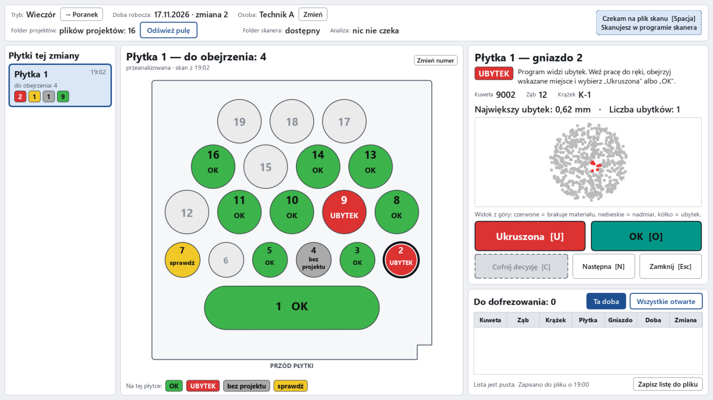
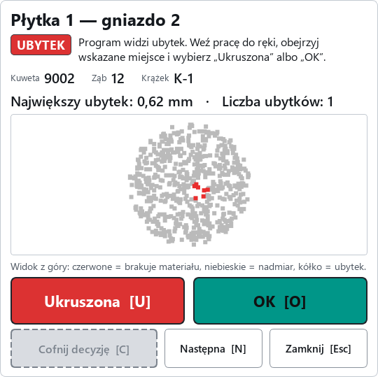
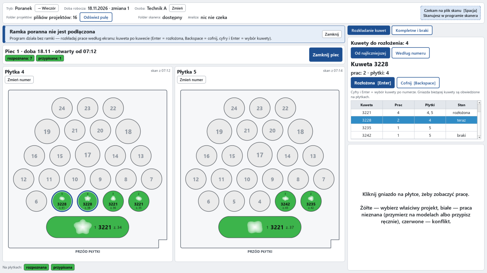
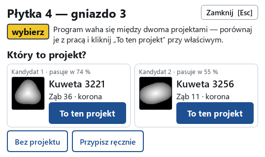

# Stanowisko kontroli prac - jedna strona

Program pokazuje na ekranie, co zrobic z kazda praca. W tej probie skaner jest udawany: skan uruchamiasz klawiszem Spacja i czekasz kilka sekund.

<!-- kolumny -->

## Wieczor - przed piecem

<!-- obok 61 -->

1. Kliknij swoje nazwisko przy pytaniu "Kto teraz pracuje?".
2. Plytka z pracami idzie do skanera. Uruchom skan. Po chwili plytka jest na liscie z lewej.
3. Zielone "OK" - nic nie robisz. Czerwone "UBYTEK" i zolte - kliknij gniazdo i obejrzyj te prace w reku.
4. Wybierz "Ukruszona" albo "OK". Pomylka: "Cofnij decyzje".
5. Komunikat "Skan do powtorzenia" i zolte "popraw ulozenie": popraw prace w gniezdzie, zeskanuj plytke jeszcze raz
   i odpowiedz "Tak, to ponowny skan".
6. Odlozone prace sa na liscie w prawym dolnym rogu, np. "Do dofrezowania: 1".

<!-- dalej -->

<!-- koniec obok -->

<!-- nowa kolumna -->

## Poranek - po piecu

<!-- obok 61 -->

1. Kliknij swoje nazwisko przy pytaniu "Kto teraz pracuje?".
2. Zeskanuj po kolei wszystkie plytki pieca.
3. Zolte "wybierz": kliknij gniazdo, porownaj prace z obrazkami i kliknij "To ten projekt".
4. Z prawej jest numer, np. "Kuweta 3228". Jej prace sa obwiedzione na plytkach. Przeloz je do kuwety i nacisnij Enter.
5. Pomylka: Backspace. Masz w reku inna kuwete: wpisz jej numer cyframi i nacisnij Enter.
6. Po ostatniej kuwecie kliknij "Zamknij piec". Czego brakuje, pokazuje np. "Braki w tym piecu: 1".

<!-- dalej -->

<!-- koniec obok -->

<!-- koniec kolumn -->

<!-- stopka: Dane na obrazkach sa sztuczne. Strona do proby T14 (E3-A11d, runda 2, 20.11.2026). -->
